> **仓库结构**：`main` 分支就是 `/workspace/anime` 的完整原目录（脚本、原始截图、
> 全部中间产物、实验记录、`models/`），文件直接放在仓库根目录。
> 对话网页版存档单独放在 **`gh-pages` 分支**：https://map9876.github.io/Anime-screenshot-collage/
> `models/lama_fp32.onnx`（208 MB）走 Git LFS，克隆后先执行 `git lfs pull`。
> 分支分工与「零配置一键生成 Pages」说明见 `gh-pages` 分支的 README。

本项目由AI开发，全程聊天记录和提示词在 gh-pages分支的json文件，可直接导入codebuddy vscode插件使用进行二次开发，codebuddy cli或别的agent的话可能需要转换json一下。源仓库 https://cnb.cool/kfc50/sonypictures-poster

---

# 当前推荐用法：一条命令跑完「拼接 → 清理 → 质检」

`collage.py` 是本仓库现在的入口；`translate_stitch.py` / `clean_stitched.py` 仍可单独运行，也被它 import 复用。再往下的内容是从 OpenCV Stitcher 开始的完整开发记录。

把一组截图放进同一个目录（帧顺序任意、可以带 letterbox 黑边），然后：

```bash
# 依赖：opencv-python-headless numpy onnxruntime
python3 collage.py 亚丝娜镜头1
python3 collage.py "frames/*.png" --out result/ --model models/lama_fp32.onnx
python3 collage.py 亚丝娜镜头1 --skip-stitch   # 复用已有 raw，只跑清理+质检
python3 collage.py --selftest                  # 曝光补偿合成自检，不读图片
```

**没有硬编码绝对路径**：工作目录按 `__file__` 解析，模型默认取脚本同目录的 `models/lama_fp32.onnx`（208 MB，Git LFS，克隆后先 `git lfs pull`），输出默认写到输入所在目录；整个目录拷到别的机器也能直接跑。

| 参数 | 作用 |
|---|---|
| `--out DIR` | 输出目录，默认与输入目录相同 |
| `--model PATH` | 指定 LaMa onnx 路径 |
| `--mode seam\|multiband\|feather` | 融合方式，默认 `seam`（GraphCut 接缝） |
| `--photometry auto\|on\|off` | 逐帧曝光补偿，默认 `auto`（按接缝台阶 A/B 自动选） |
| `--no-clean` | 只拼接、不清理 |
| `--skip-stitch` | 用已有 `translate_stitched_raw.png` 只跑清理+质检 |

产物（都在输出目录）：

| 文件 | 内容 |
|---|---|
| `translate_stitched_raw.png` | 未裁边的原始拼接画布（清理阶段的输入） |
| `translate_stitched.png` | 裁掉黑边后的拼接图 |
| `translate_stitched_clean.png` | 清理黑块、修补、修复接缝后的**最终图** |
| `seam_mask.png` | GraphCut 接缝位置 |
| `qc_report.json` | 三个阶段的尺寸、均值亮度、黑区占比、最大行/列亮度跳变 |

## 本轮开发：曝光补偿前移 + 自动 A/B + 量化质检

以前只有清理阶段事后用斜坡去压接缝台阶；现在在**拼接阶段**就把各帧的亮度/色温拉到同一基准：

1. `exposure_chain()`：任意两个有重叠的帧，在重叠有效像素上估计逐通道 `gain/offset`（最小二乘斜率 + 中位数残差，向 1 收缩以抵抗视差），再沿**重叠像素最多的最大生成树**传播到 anchor 帧，不再只对齐到第一帧。
2. `photometry=auto`：不做主观判断——同一布局分别跑「关/开」两套融合，用 `seam_cost()` 只在接缝附近的有效行上算亮度台阶，开补偿后至少好 2% 才启用。
3. `qc_report.json`：把「黑区残留、行/列最大跳变」变成可比较的数字，回归时直接 diff。

`--selftest` 用合成的三帧不同曝光序列验证补偿链，重叠区 MAE `10.29/19.77 → 1.46/3.17`。

### 三组真实素材实测

| 素材 | 曝光补偿 A/B | 最终尺寸 | 纯黑区 | 最大行跳变 | 最大列跳变 |
|---|---|---|---|---|---|
| 亚丝娜镜头1（6 帧） | 关 10.00 / 开 5.54 → **启用** | 1574×3652 | 5.223% → 0.000% | 26.55 → 4.84 | 70.57 → 2.74 |
| 亚丝娜镜头2（3 帧） | 关 2.00 / 开 8.86 → **跳过** | 2134×1649 | 5.470% → 0.000% | 94.26 → 2.23 | 105.08 → 3.32 |
| 龙猫（4 帧） | 关 5.64 / 开 5.15 → **启用** | 2130×2061 | 6.706% → 0.000% | 26.55 → 4.17 | 20.10 → 1.32 |

镜头2 自动**跳过**是关键：它的帧间差异主要是内容/水印而不是曝光，硬套逐帧补偿反而放大局部台阶（8.86 > 2.00）。三组素材黑区全部清零，说明 A/B 判据和清理流程都不依赖特定图。

---

# 垂直三段截图 → 拼接成一张完整图（OpenCV Stitcher）

## 场景
三张**同一镜头的垂直三段**截图（动画画面），彼此是**纯平移**关系（无旋转、无缩放），只需沿垂直方向对齐即可拼成一张完整图。

| 顺序 | 文件 | 画面内容 |
|---|---|---|
| 最上 | `image.a89eba6335.png` | 情侣拥抱的**上半身** |
| 中间 | `image.d8464ec779.png` | 两人的**腿部** |
| 最下 | `image.6d2e71a026.png` | 两人的**脚部** |

三张图尺寸（宽×高）：1080×593、1080×607、1080×451。

## 输入图

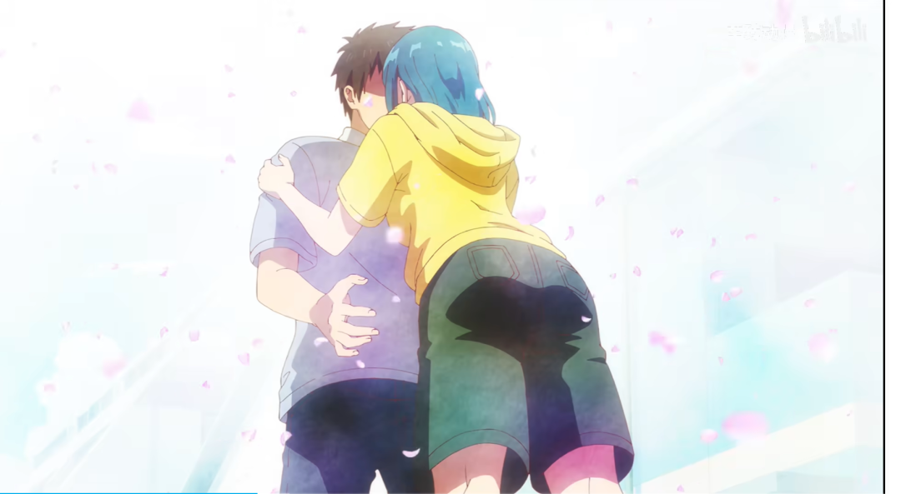
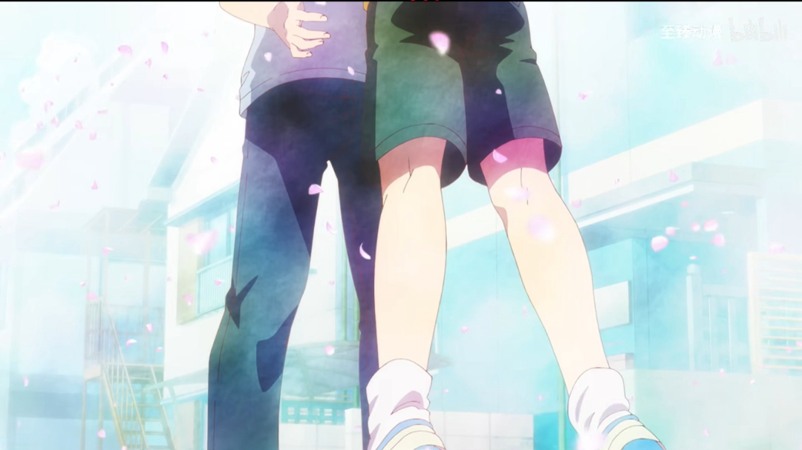
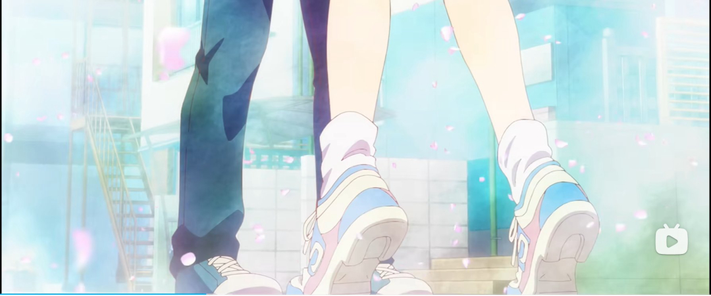

## 技术路线
1. **特征提取**：SIFT 检测关键点 + 描述子。
2. **两两匹配 + RANSAC**：用 `cv2.findHomography(RANSAC)` 估计相邻图的变换，诊断是否为纯平移、偏移多少。
3. **自动拼接**：`cv2.Stitcher_create(Stitcher_PANORAMA)` 一次性把三张拼成全景。
4. **裁剪黑边**：单应变换会在画布边缘留下黑边，按"非黑像素比例"投影裁剪。

> 关键诊断结论：**三张是纯平移（scale≈1.00）**，因此全局单应即可、精度高、几乎无重影。若是曲线轨迹/有视差，则需改用 APAP / MeshFlow（见 `/workspace/implementation_plan.md`）。

## 环境准备
```bash
cd /workspace
uv venv .venv
uv pip install --python .venv/bin/python opencv-python-headless numpy
```

## 完整代码

### 1) 诊断脚本 `diag.py`（看匹配关系与位移）
```python
import cv2, numpy as np, os, itertools

d = '/workspace/anime'
files = sorted([f for f in os.listdir(d) if f.lower().endswith('.png')])
imgs = [cv2.imread(os.path.join(d, f)) for f in files]

print("files:")
for f, im in zip(files, imgs):
    print("  ", f, None if im is None else im.shape)

sift = cv2.SIFT_create()
kps, dess = [], []
for im in imgs:
    g = cv2.cvtColor(im, cv2.COLOR_BGR2GRAY)
    kp, de = sift.detectAndCompute(g, None)
    kps.append(kp); dess.append(de)
    print("  kp", len(kp))

bf = cv2.BFMatcher()
for i, j in itertools.combinations(range(len(imgs)), 2):
    if dess[i] is None or dess[j] is None:
        continue
    m = bf.knnMatch(dess[i], dess[j], k=2)
    good = [a for a, b in m if a.distance < 0.75 * b.distance]
    line = f"pair {i}-{j}: good={len(good)}"
    if len(good) >= 10:
        src = np.float32([kps[i][g.queryIdx].pt for g in good]).reshape(-1, 1, 2)
        dst = np.float32([kps[j][g.trainIdx].pt for g in good]).reshape(-1, 1, 2)
        H, mask = cv2.findHomography(src, dst, cv2.RANSAC, 5.0)
        if H is not None:
            inl = int(mask.sum())
            line += f" inliers={inl} tx={H[0,2]:.1f} ty={H[1,2]:.1f} scale~{np.sqrt(H[0,0]**2+H[1,0]**2):.2f}"
    print(line)

try:
    st = cv2.Stitcher_create(cv2.Stitcher_PANORAMA)
    status, out = st.stitch(imgs)
    print("stitcher status", status)
    if status == cv2.Stitcher_OK:
        cv2.imwrite(os.path.join(d, 'stitched_auto.png'), out)
        print("saved stitched_auto.png", out.shape)
except Exception as e:
    print("stitcher err", e)
```

### 2) 拼接 + 裁剪脚本 `stitch.py`
```python
import cv2, numpy as np, os

d = '/workspace/anime'
# 明确从上到下的顺序
files = ['image.a89eba6335.png', 'image.d8464ec779.png', 'image.6d2e71a026.png']
imgs = [cv2.imread(os.path.join(d, f)) for f in files]

st = cv2.Stitcher_create(cv2.Stitcher_PANORAMA)
status, pano = st.stitch(imgs)
if status != cv2.Stitcher_OK:
    raise SystemExit(f"stitcher failed, status={status}")

cv2.imwrite(os.path.join(d, 'stitched_auto.png'), pano)
print("stitched_auto.png", pano.shape)

# 按"非黑像素比例"投影裁剪黑边
g = cv2.cvtColor(pano, cv2.COLOR_BGR2GRAY)
mask = (g > 15).astype(np.uint8)
cf = mask.mean(axis=0); rf = mask.mean(axis=1)
cols = np.where(cf > 0.6)[0]; rows = np.where(rf > 0.6)[0]
if len(cols) and len(rows):
    x0, x1 = cols.min(), cols.max()
    y0, y1 = rows.min(), rows.max()
    crop = pano[y0:y1+1, x0:x1+1]
    cv2.imwrite(os.path.join(d, 'stitched_final.png'), crop)
    print("stitched_final.png", crop.shape)
```

## 运行
```bash
cd /workspace
.venv/bin/python anime/diag.py     # 诊断：匹配/位移 + 自动拼接
.venv/bin/python anime/stitch.py   # 生成 stitched_auto.png / stitched_final.png
```

## 诊断输出（实测）
```
files:
   image.6d2e71a026.png (451, 1080)
   image.a89eba6335.png (593, 1080)
   image.d8464ec779.png (607, 1080)
pair 0-1: good=3                       # 脚部 vs 上半身，几乎无重叠
pair 0-2: good=57 inliers=43 tx=7.3  ty=313.6  scale~1.00   # 脚→腿：垂直下移 313.6
pair 1-2: good=86 inliers=60 tx=-19.2 ty=-359.6 scale~1.02  # 上→腿：垂直上移 359.6
stitcher status 0                      # OK
saved stitched_auto.png (1131, 1274)   # 1274×1131
```
裁剪后 `stitched_final.png` 尺寸 **1156×1113**（去掉了左右黑边）。

## 输出图

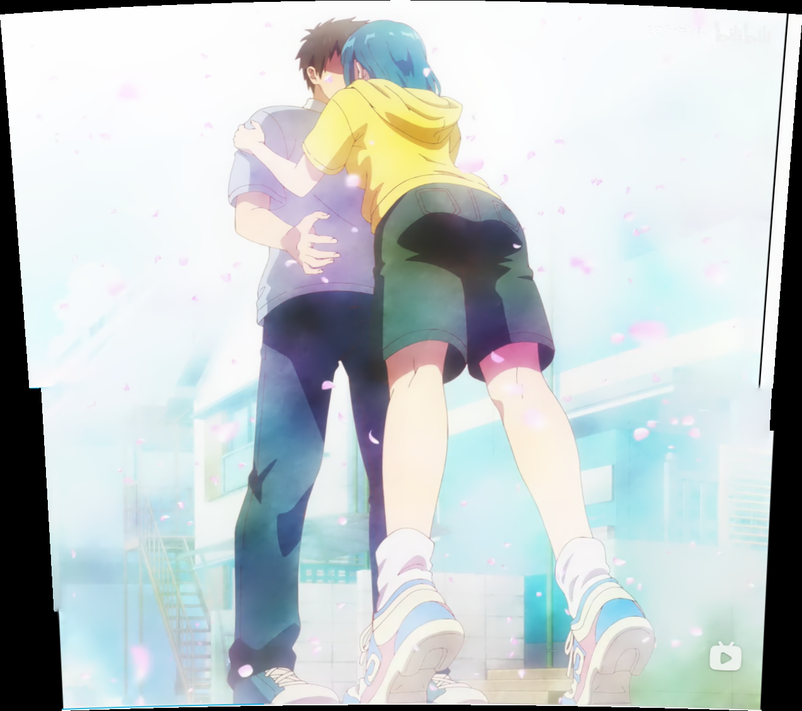
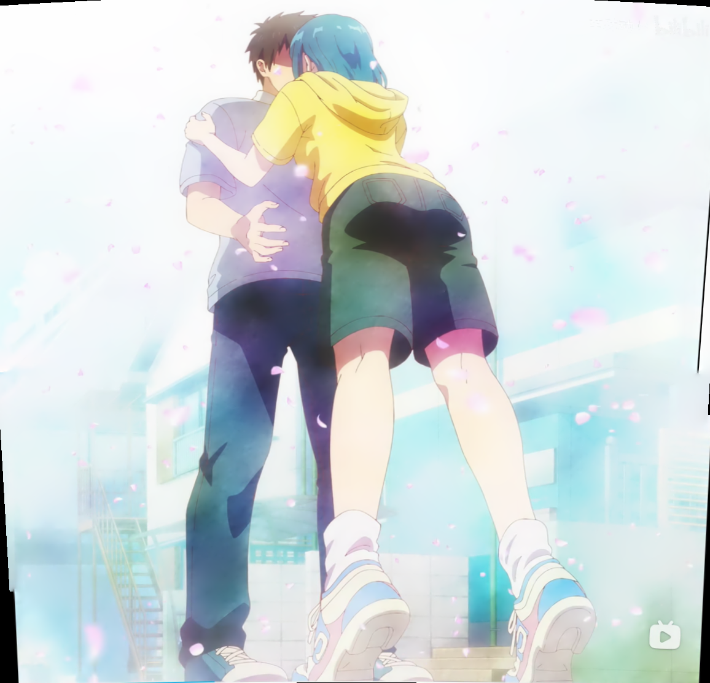

## 结果说明
- 拼接顺序（从上到下）：`a89`（拥抱上半身）→ `d84`（腿部）→ `6d2`（脚部）。
- 因是**纯平移/摇镜头**，全局单即够用；若是曲线轨迹/有视差，应改用 APAP / MeshFlow 局部形变对齐（见 `/workspace/implementation_plan.md`、`/workspace/literature_roadmap.md`）。
- 输出文件：`stitched_auto.png`（原始拼接）、`stitched_final.png`（裁黑边最终版）。

## OpenCV Stitcher 机制问答

**Q1：它是左右自动对齐了吗？还微调整了图片大小？**
是的。Stitcher 对每对图用特征匹配 + RANSAC 估计 **3×3 单应矩阵 H**（含平移 `tx/ty`、缩放、旋转、剪切），自动对齐。三张原分辨率不同（1080×593 / 1080×607 / 1080×451）却能拼合，正因为它按特征估计变换对齐、可对每张图施加微缩放，而非按像素网格对齐。这就是你看到的"自动调整微微大小"。

**Q2：重叠区是简单三图拼一起，还是相互叠加？**
是**重叠区相互叠加/融合**，不是硬拼：
1. 特征匹配 → 估计变换 → 把所有图 warp 到统一画布；
2. **接缝估计（Seam Estimation）**：在重叠区用图割找一条最优接缝线（最小颜色/梯度代价），不是固定"10 高度"或"90 高度"，而是逐像素沿最优路径决定每点归属哪张图；
3. **多频段融合（Multi-band Blending）**：在接缝两侧做拉普拉斯金字塔融合，重叠区两图内容都被混合（你中有我、我中有你），消除硬边与重影。

**Q3：锯齿 / 阶梯 / 倒锥状斜边是怎么来的？**
单应变换把图放进矩形画布后，图像外边界被透视切成斜线，而画布是矩形 → 边缘呈斜切/阶梯状锯齿。这是变换边界效应 + 像素插值的 aliasing，不是没对齐。可在融合时做遮罩羽化缓解，但画布斜切边界是几何必然。

**Q4：分辨率不一样、只差一两个像素能拼吗？**
能。它是按特征对齐，不是像素对齐。用选框截图导致左右偏移一两个像素、分辨率略有差异，Stitcher 仍能用特征估计亚像素级变换对齐——本例三张分辨率本就不同且成功拼合即为证明。

**Q5：花瓣飘动却合成完美，是叠加了很多层吗？**
只有 3 张。重叠区做了接缝 + 多频段融合，对齐的是人物/建筑等稳定特征；花瓣在不同帧位置不同，但在重叠区被融合（取接缝一侧或混合），所以看不出破绽。观感"平滑"是融合的结果，而非很多层叠加。

## 裁剪鲁棒性测试

验证"即使裁掉部分重叠区，只要剩余重叠有足够特征，仍能拼合"。脚本 `test_crops.py`：

```python
import cv2, numpy as np, os
d = '/workspace/anime'

def stitch(imgs, outname):
    st = cv2.Stitcher_create(cv2.Stitcher_PANORAMA)
    status, pano = st.stitch(imgs)
    if status == cv2.Stitcher_OK:
        cv2.imwrite(os.path.join(d, outname), pano)
        print(f"  => {outname}: OK  {pano.shape}")
    else:
        print(f"  => {outname}: FAILED  status={status}")

a89  = cv2.imread(d + '/image.a89eba6335.png')
d84  = cv2.imread(d + '/image.d8464ec779.png')
foot = cv2.imread(d + '/image.6d2e71a026.png')

# 测试 A：最底脚图 左侧 20% 裁掉
h, w = foot.shape[:2]
footA = foot[:, int(w * 0.2):, :]
cv2.imwrite(d + '/testA_foot_left20.png', footA)
stitch([a89, d84, footA], 'testA_stitched.png')

# 测试 B：最底脚图 左侧 20% + 下方 20%（重合区）裁掉
footB = foot[:int(h * 0.8), int(w * 0.2):, :]
cv2.imwrite(d + '/testB_foot_left20_bottom20.png', footB)
stitch([a89, d84, footB], 'testB_stitched.png')
```

运行：`.venv/bin/python anime/test_crops.py`

### 测试 A：最底脚图左侧 20% 裁掉
- 输入：`image.6d2e71a026.png`（1080×451）→ 裁左 20% → `testA_foot_left20.png`（864×451）
- 其余两张不变：`image.a89eba6335.png`、`image.d8464ec779.png`
- 结果：**拼接成功**，输出 `testA_stitched.png`（1111×1119）
- 说明：脚图与腿图的重叠主要在鞋/裤脚区域，裁掉左侧 20% 后右侧鞋/裤脚仍保留足够重叠特征。

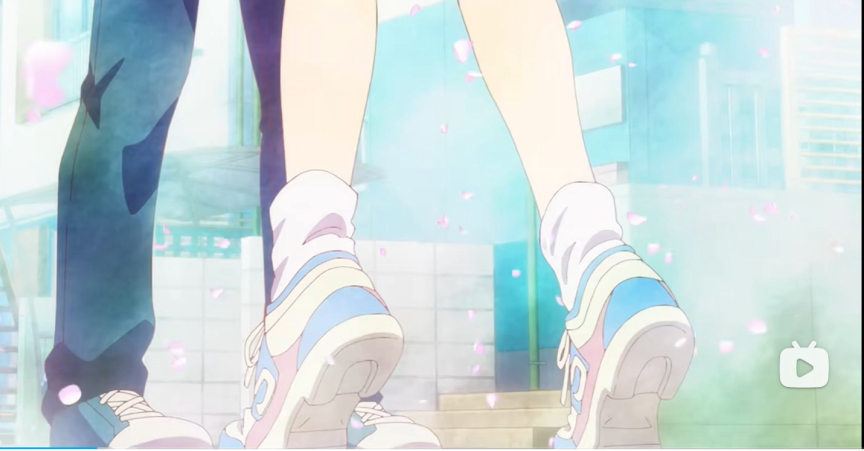
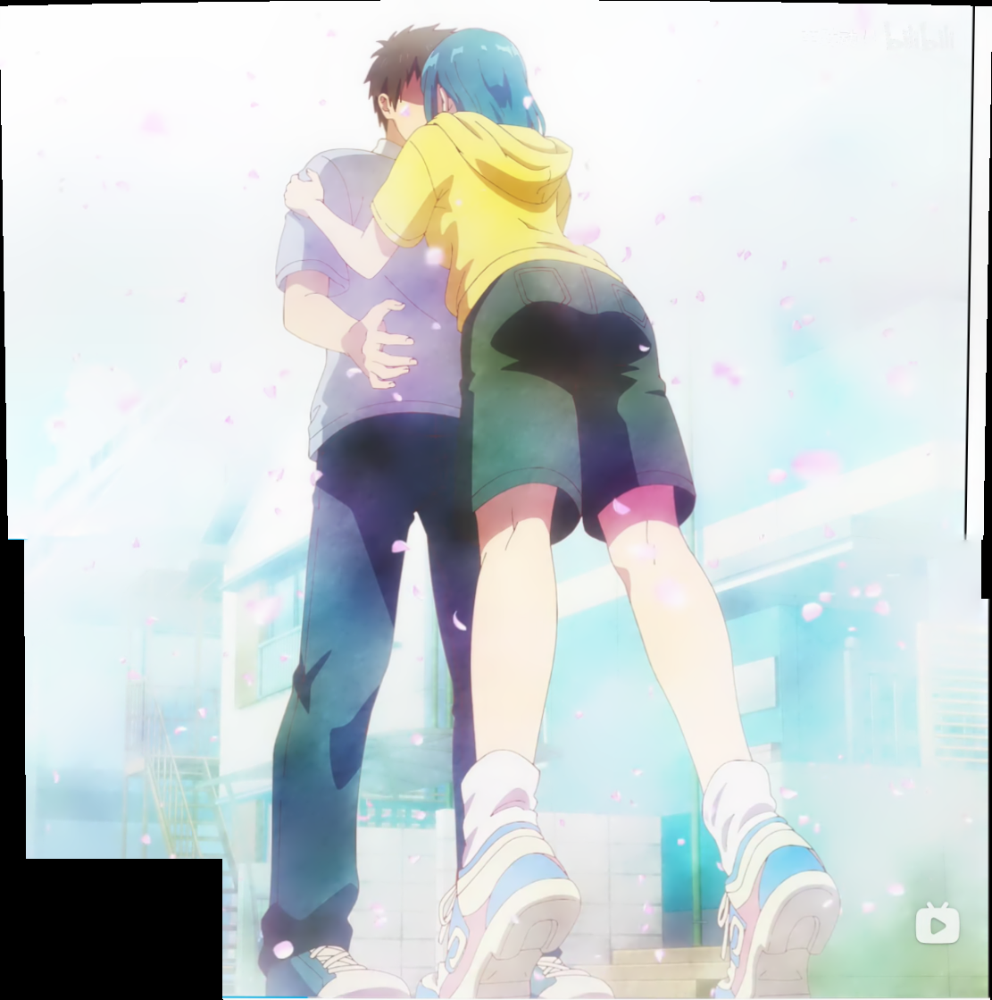

### 测试 B：最底脚图左侧 20% + 下方 20%（重合区）裁掉
- 输入：`image.6d2e71a026.png`（1080×451）→ 裁左 20% 且裁下 20% → `testB_foot_left20_bottom20.png`（864×360）
- 结果：**拼接成功**，输出 `testB_stitched.png`（1110×1030）
- 说明：即便同时削掉左下角（与腿图重叠最多的区域），只要剩余重叠区仍有可匹配纹理，Stitcher 仍能对齐。继续裁到重叠不足则会失败（status≠0）。

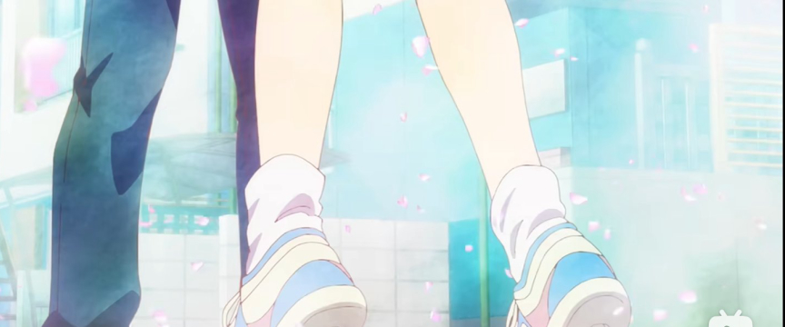
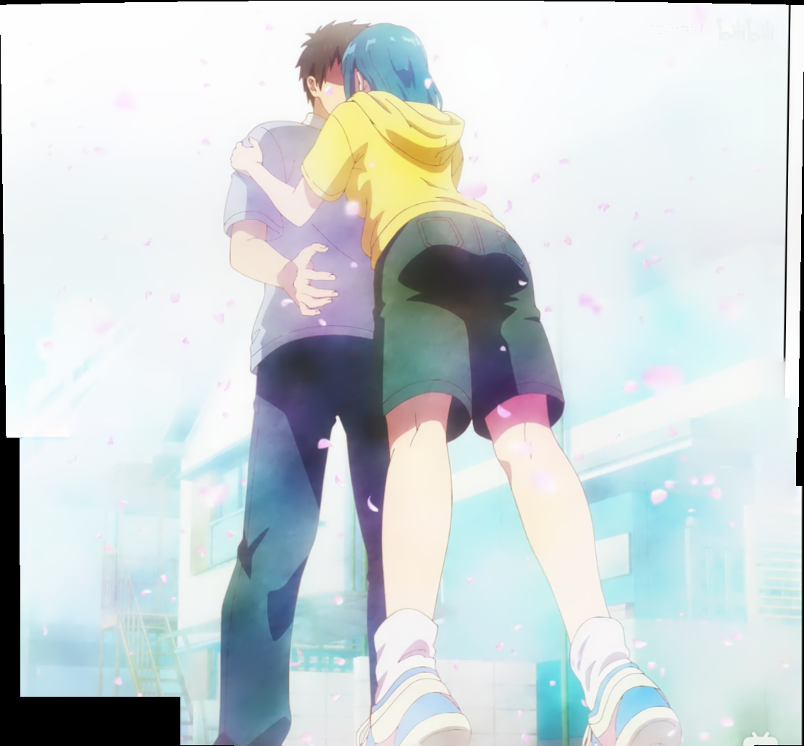

### 结论
- OpenCV Stitcher 对**平移 + 轻微缩放/偏移 + 部分重叠缺失**具有鲁棒性，核心是相邻图重叠区要有**可匹配的特征纹理**。
- 若重叠被裁到几乎没有共同特征，拼接会失败——一般建议相邻图保留 **≥20%~30% 重叠**。
- 更普遍情况（曲线轨迹/视差/大位移）：全局单应失效，应改用 APAP（局部单应）、MeshFlow（运动网格）或光流/稠密对应，见 `/workspace/implementation_plan.md`、`/workspace/literature_roadmap.md`。

## ⚠️ 透视畸变警告（不要用默认 Stitcher 的透视投影）

**现象（实测）**：
- 用 OpenCV `Stitcher`（PANORAMA 默认**透视单应**）拼接后，**人物头部被拉宽、比例改变**——图像发生了非均匀缩放与剪切扭曲。
- 同类问题在建筑物拼接中很典型：原本笔直的楼房边缘被拼成**曲线/弯曲**（见 [cnblogs 案例](https://www.cnblogs.com/ybqjymy/p/14182699.html)）。

**根因**：
- `Stitcher` 默认把所有图 warp 到一个**透视平面**（3×3 单应 H，含旋转+缩放+剪切+投影）。为对齐重叠区，它会做**非均匀缩放/剪切**，导致内容扭曲。
- 透视投影本质会放大"近大远小/倾斜"，直线落在非正视平面上会变成曲线。

**为什么不该对图片特调**：
- 针对某张图手动修正比例是"头痛医头"，换一组图又会出问题。应找**通用、按运动模型自适应**的方法（见下）。

## 不扭曲图片的通用方法

核心原则：**用能对齐的最小自由度变换模型**——自由度越低，扭曲越小。

| 模型 | 自由度 | 是否扭曲形状 | 适用场景 |
|---|---|---|---|
| 纯平移 Translation | 2 | **零扭曲**（不动形状/大小） | 相机仅平移 / 选框截图平移 |
| 相似 Similarity | 4 | 仅整体缩放/旋转（保形状） | 绕光心旋转+缩放 |
| 仿射 Affine | 6 | 会（非均匀缩放/剪切） | 平面倾斜 |
| 透视 Perspective | 8 | **明显**（本例扭曲来源） | 宽视场/大角度（Stitcher 默认） |

**通用策略**：
1. **运动模型自选择**：先试 平移 → 相似 → 仿射 → 透视，取最简单的可对齐模型。能用平移就不用更高阶。
2. **本场景最优 = 纯平移拼接**：三张是纯平移（诊断 `scale≈1.00`、仅 `ty` 偏移），根本不需要透视。改用平移对齐 + 重叠融合 → **零扭曲**。
3. **柱面/球面投影**（标准全景）：先把图投影到柱面/球面再拼，减轻透视收缩；但对近距离/大视差仍会弯曲，非万能。
4. **APAP / 局部相似对齐**：局部用相似/仿射而非透视，减少扭曲（as-projective-as-possible），见 `apap_experiment.md`。
5. **实现层面替代**：用 `cv2.estimateAffinePartial2D`（相似/仿射）或相位相关/光流（纯平移）替代 `cv2.findHomography`（透视）。

**针对本例的修正建议（已实现验证）**：
用**纯平移累积拼接**重做（脚本 `translate_stitch.py`）：SIFT 估计相邻平移（亚像素），按**累积平移**放置到画布（只平移、不做透视/仿射 warp），重叠区平均。结果 `translate_stitched.png`：**人物头部比例正常、建筑直线保持笔直**，零形状扭曲；代价是亚像素位移导致接缝细线 + 左右少量黑边。

### 黑盒无损拼接 `translate_stitch.py`：命令与输入输出

代码**不指定图片顺序**（对输入"无知"）：任意顺序输入，自动按重叠关系判断谁上谁下。

```bash
cd /workspace
.venv/bin/python anime/translate_stitch.py          # 输出 translate_stitched.png
.venv/bin/python anime/translate_stitch.py --demo    # 额外输出 staircase_demo.png
```

- **输入**：目录下所有 `image.*.png`（3 张，任意顺序；也可传 glob 自定义）。
- **输出**：`translate_stitched.png`（无损、零形状扭曲）；`--demo` 额外输出 `staircase_demo.png`。
- **自动布局**：SIFT 估计两两平移 → 仅保留"偏移一致"的重叠对（过滤非重叠图的虚假匹配）→ BFS 传播全局位置；谁上谁下由重叠关系决定，anchor 自动取邻居最多者。
- **实测**：文件名排序为 `6d2, a89, d84`（并非人工的"上中下"），自动布局得 `a89` 在上（相对 `d84` 上移 349）、`6d2` 在下（下移 314），输出 1115×1095，**结果与输入顺序无关**。
- **修复记录**：早期 `zip(ims, pos.values())` 因 dict 顺序 ≠ 索引导致图与位置错配（上下颠倒），已改为 `[pos[i] for i in range(n)]` 显式按索引取位置。

**通用无损方案：任意方向平移的"楼梯式锯齿"累积拼接**
- 只要镜头是**纯平移（任意方向，如左上 45°）**，相邻帧只差平移量 → 把每帧按累积平移直接放置即可**无损还原**大图，无需透视 warp。
- 当位移方向非轴对齐时，边缘自然呈**楼梯式锯齿状**（`staircase_demo.png`），但**内容零扭曲**（每块仅平移，没有形变）。
- 真无损要求位移为整数像素；亚像素位移可用亚像素平移（`warpAffine` 纯平移，仅插值、不改变形状）或对重叠区做羽化/多频段融合消除细缝。

**三种结果对比**
| 方法 | 文件 | 头部比例 | 建筑直线 | 边缘 | 结论 |
|---|---|---|---|---|---|
| 透视 Stitcher | `stitched_final.png` | **变宽（扭曲）** | 可能弯曲 | 斜切锯齿 | 有畸变 |
| 无损平移累积 | `translate_stitched.png` | **正常** | **笔直** | 接缝细线/黑边 | 零扭曲（推荐） |
| 左上 45° 楼梯累积 | `staircase_demo.png` | 正常 | 笔直 | **楼梯锯齿** | 任意方向无损 |

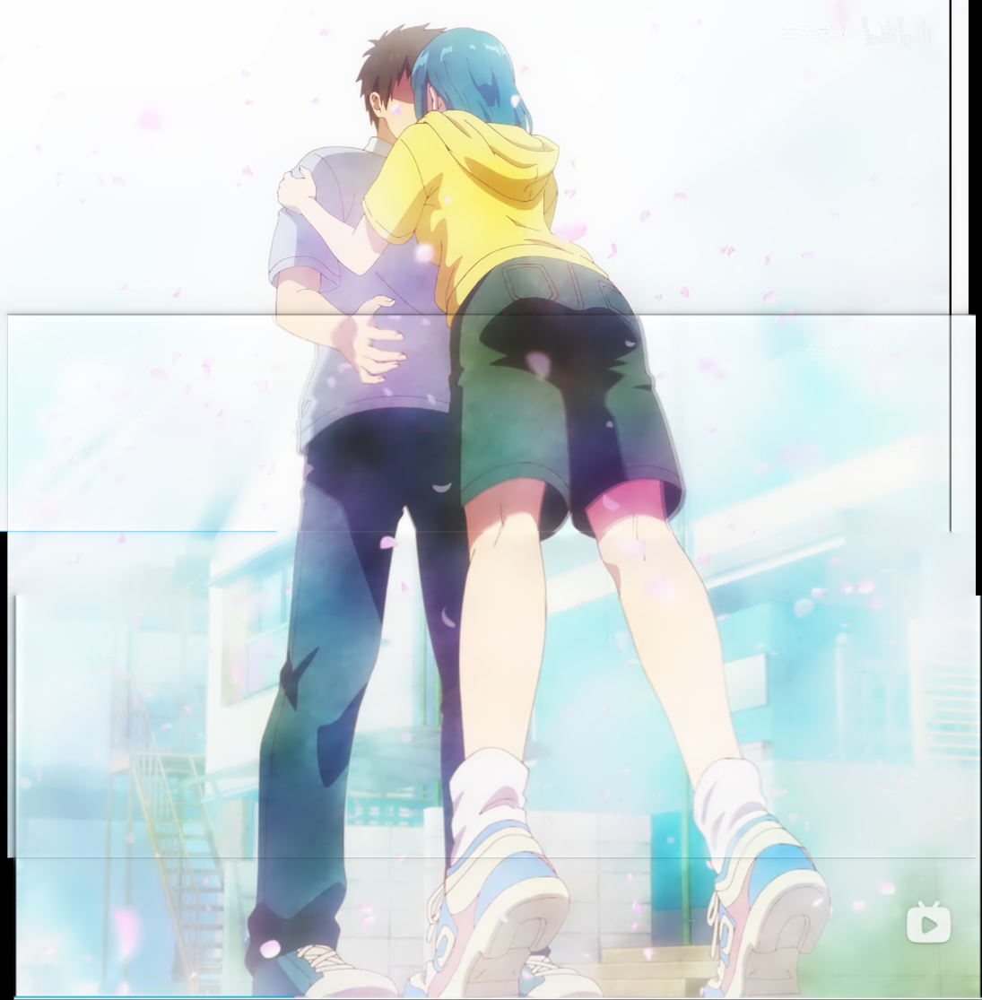
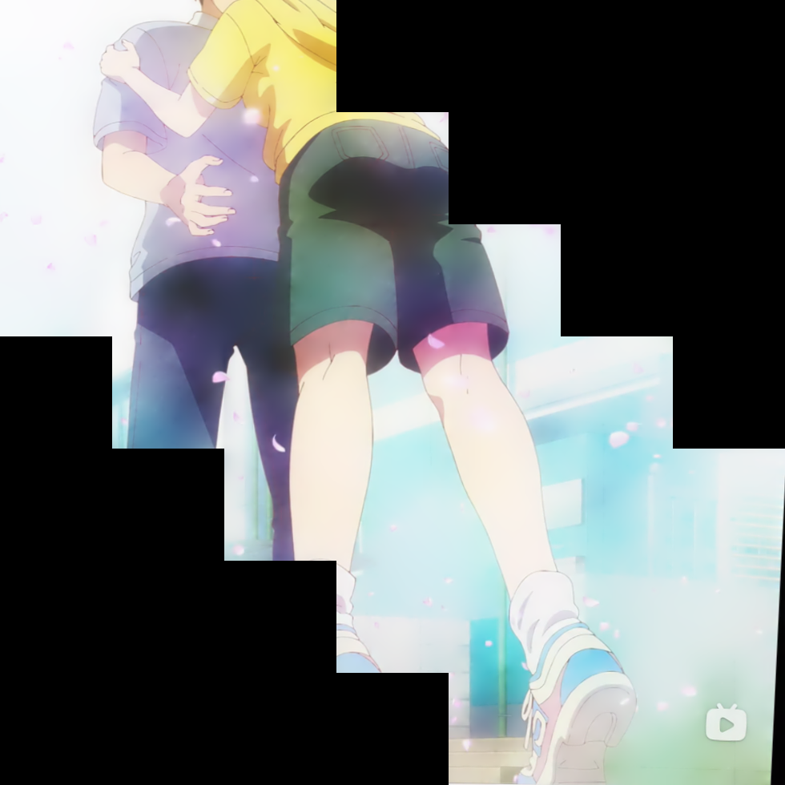

**亚像素平滑版**：`translate_stitched_smooth.png`（脚本 `translate_stitch_smooth.py`）用亚像素纯平移 `warpAffine` + 有效区平均，消除取整误差。但接缝细线主要来自**不同帧重叠区内容本身的差异**（花瓣飘动、光照/画面不同帧），而非位移误差——若要接缝更自然，需在同一帧内取重叠、或做多频段融合/接缝优化；若位移取整为整数且重叠内容完全一致，则可做到真正逐像素无损。

### 接缝优化：GraphCutSeamFinder（借鉴 Stitcher 源码）

实测：`MultiBandBlender`（多频段）和 `FeatherBlender`（羽化）**都消不掉**三张不同截图在重叠区的**矩形边界水平线**。改用 OpenCV `GraphCutSeamFinder`（`COST_COLOR_GRAD`，沿颜色/梯度最小代价找接缝，把边界藏到人物/建筑边缘）后，水平硬线基本消失。

```bash
.venv/bin/python anime/translate_stitch.py --seam    # 输出 translate_stitched_seam.png
.venv/bin/python anime/translate_stitch.py --feather # 输出 translate_stitched_feather.png
```

- 输入输出同黑盒版；`--seam` 输出 `translate_stitched_seam.png`，`--feather` 输出 `translate_stitched_feather.png`。
- 融合方式可选：默认 `MultiBandBlender`；`--feather` 羽化；`--seam` 图割接缝。
- 效果：水平线基本消失、过渡自然；代价是画布外缘出现**不规则黑边**（图割边界形状），可后续裁剪/补边。
- 对应 OpenCV Stitcher 源码：`seam_finders.cpp`（GraphCut）+ `blenders.cpp`（MultiBand/Feather）。

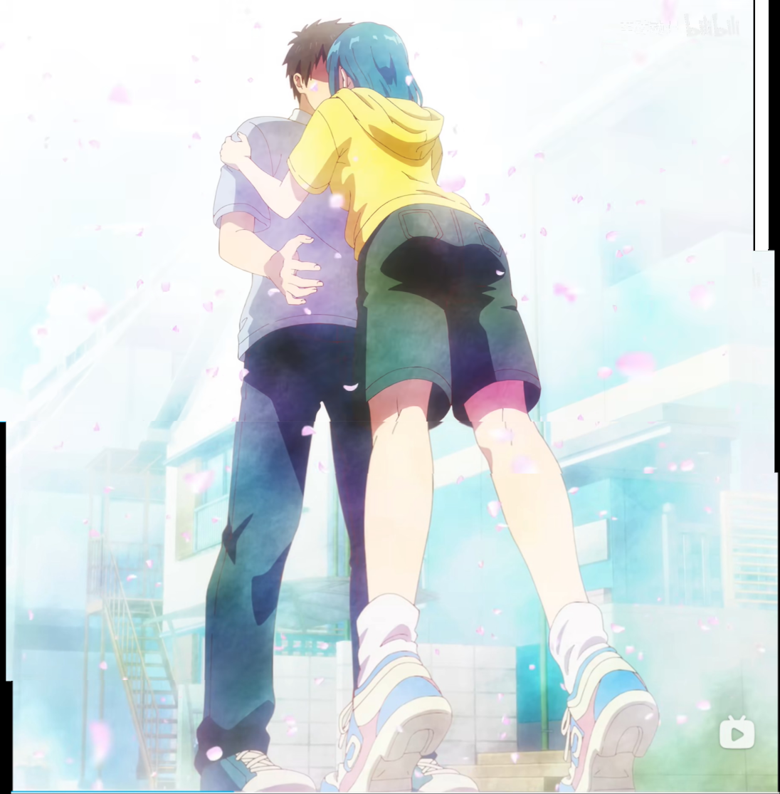

## 普适性测试：亚丝娜 镜头1 / 镜头2

针对真实截图的两个难点（四周黑边、水/冰晶重复纹理、极淡画面）做了通用改进（不特调）：

- **自动裁黑边** `crop_black_border`：保守检测"列/行非黑比例"，无黑边图保持原样。镜头1 四周 letterbox 黑边必须裁掉，否则相位相关/SIFT 会把整幅图按黑边钉死为 0 位移。
- **自适应匹配 + 纯平移 RANSAC + 最大生成树**：每对图同时用原图与 CLAHE 各算一次纯平移 RANSAC，按**内点率**取更可靠者（冰晶 CLAHE 内点多、水雾原图内点率高）；布局用内点数作边权的 **Kruskal 最大生成树**，强边优先，避免淡图弱边把位置拉错。
- **glob 排除历史输出 + 孤立图容错**（不再 KeyError）。

```bash
.venv/bin/python anime/translate_stitch.py "/workspace/anime/亚丝娜镜头1"
.venv/bin/python anime/translate_stitch.py "/workspace/anime/亚丝娜镜头2"
```

| 镜头 | 输入 | 现象 | 结果 |
|---|---|---|---|
| 镜头1 | 6 张 | 垂直摇镜 + 轻微抖动 + 四周黑边 | 裁边后检测到纯垂直位移（x≈0，y +1516→-1046），拼成 **3658×1953 全身像**（头顶→脸→白裙→腿→脚），无扭曲 |
| 镜头2 | 3 张 | 水/水雾+武器，极淡，图0/图1 同帧 | 自适应找回图2 真实位移 (236,449)，**同帧去重丢淡图0** → 拼接成 **1650×2371** 亚丝娜特写 |

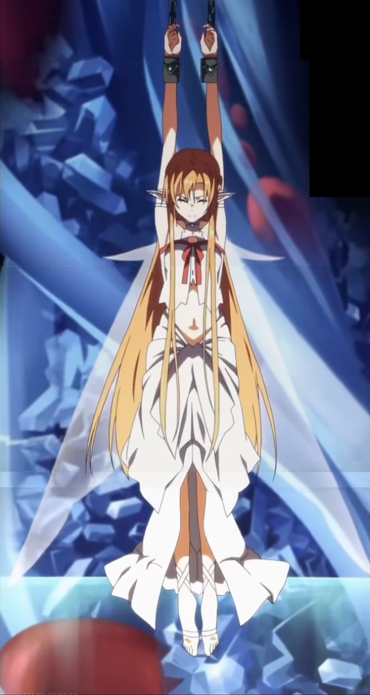
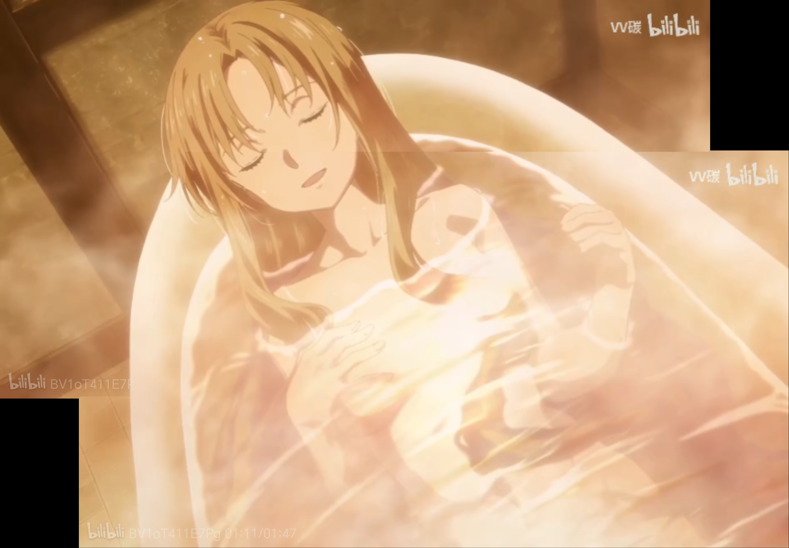

**结论**：黑边会自动裁（不特调）；重复纹理/低对比靠"纯平移约束 + CLAHE"攻克；若帧间几乎无位移（镜头2），拼接退化为叠加，属数据本身限制。

### 镜头1 接缝优化（方案 A：GraphCut + 下采样加速）

- **边缘黑线**：输出后 `trim_dark_edges` + `crop_black_border` 裁掉，图1 边缘黑线基本消失（仅左上/右上极小角）。
- **水平接缝线**：`MultiBandBlender` / `FeatherBlender` 都消不掉（图边界导致）；改用 `--seam`（`GraphCutSeamFinder` 沿内容找缝）后水平线基本消失，接缝藏到冰晶/裙摆边缘。
- **加速**：6 张大图（3658×1948）直接在原分辨率上图割会超时；改为 **1/4 分辨率找接缝 + 上采样 mask**（约快 16×），跑通。
- **默认自动，无需任何参数**：程序内部默认走 GraphCut 接缝；输入只需给目录/图片。
  ```bash
  .venv/bin/python anime/translate_stitch.py "/workspace/anime/亚丝娜镜头1"
  # → 亚丝娜镜头1/translate_stitched.png（3658×1945，水平线消失）
  ```
- **技术手段单独保留**（手动覆盖默认）：`--multiband`（多频段）、`--feather`（羽化）、`--seam`（显式图割，与默认等价）。
- **同帧去重 + 无位移选帧**：位移≈0 的图组只保留最清晰一张（Laplacian 方差最大），避免淡图覆盖清晰图；若去重后只剩 1 张才直接输出。镜头2 图0/图1 同帧 → 丢淡图0，图2 位移 (236,449) 正常拼接。

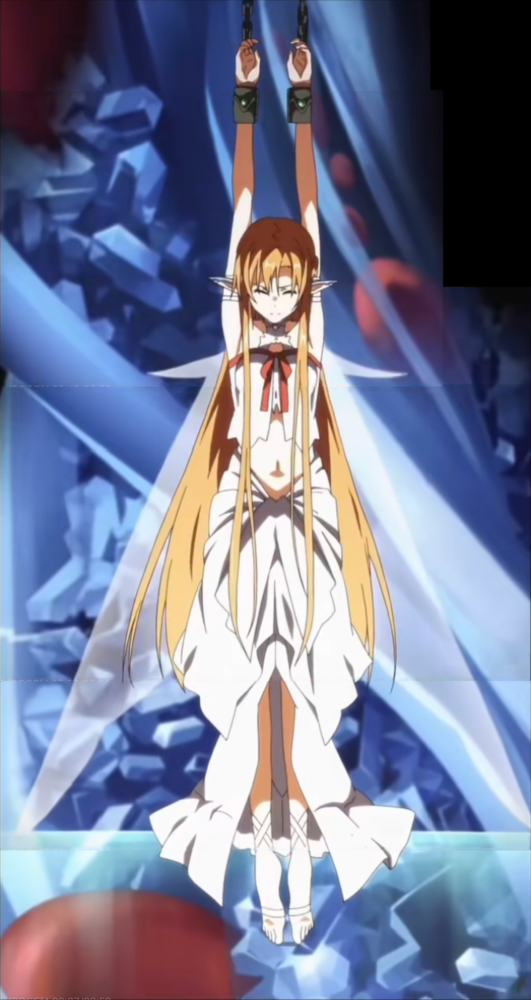

**论文/方法映射（方案 A）**：
- 纯平移 RANSAC 对齐 ← Brown & Lowe 基线；
- GraphCut 最优接缝 + 多频段/羽化融合 ← Szeliski 全景拼接、多频段融合；
- APAP（局部网格单应）/ MeshFlow（运动网格）→ 用于**视差/曲线轨迹**（已由 `apap_experiment.md` 在合成视差上验证）；本批亚丝娜镜头是**纯平移**，APAP 会退化为平移，故不触发。
- 深度视差容忍（方案 B）→ 视差严重时再上。

## 镜头2 执行与输入输出

**执行命令**
```bash
cd /workspace
.venv/bin/python anime/translate_stitch.py "/workspace/anime/亚丝娜镜头2"
# → 亚丝娜镜头2/translate_stitched.png
```

**输入（3 张，任意顺序）**

| # | 文件 | 说明 |
|---|---|---|
| 0 | `亚丝娜镜头2/6714217936404682.png` | 极淡水面过渡帧（几乎无人物） |
| 1 | `亚丝娜镜头2/7062617936404752.png` | 亚丝娜闭眼水面特写 |
| 2 | `亚丝娜镜头2/7326817936404802.png` | 亚丝娜特写（微变、斜向上运镜） |

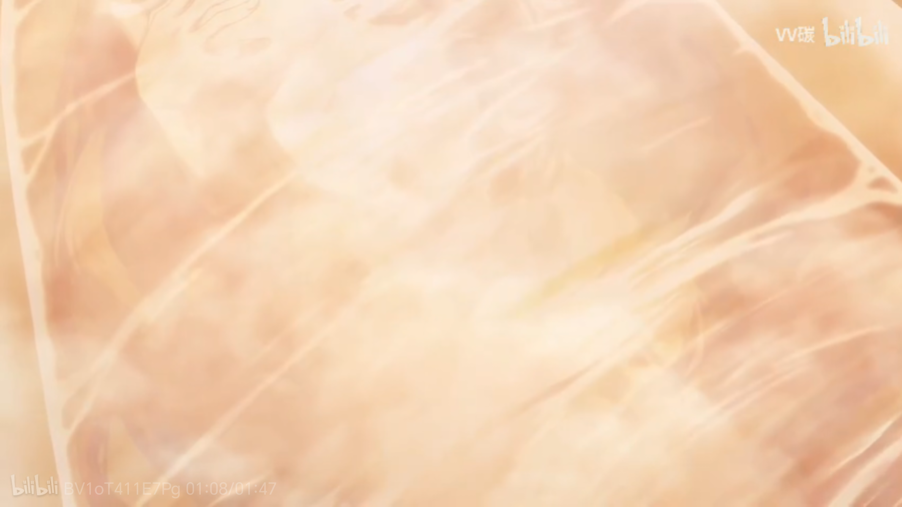
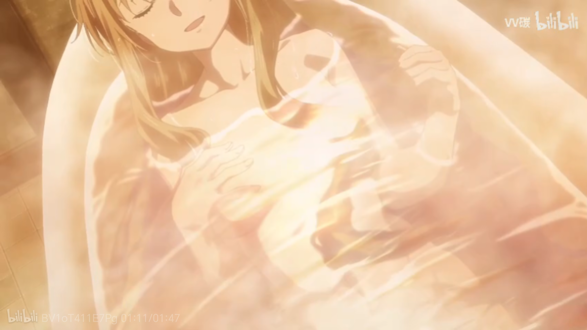


**输出（1650×2371）**


**处理过程**：图0/图1 几乎同帧（位移 <2px）→ 同帧去重丢弃淡图0；自适应按内点率找回图2 相对图0 的位移 (236,449)；MST 布局 + GraphCut 接缝融合 → 输出清晰的亚丝娜水面特写。

---

## 黑块清理 + 接缝修复：`clean_stitched.py`

拼接产物 `translate_stitched_raw.png` 仍有三类问题，全部由 `clean_stitched.py` 一次性解决（脚本独立、可复现）：

| 问题 | 现象 | 根因 |
|---|---|---|
| 未覆盖黑区 | 画面右/角落有纯黑矩形（部分帧没覆盖到的画布） | 平移放图后画布留白 |
| 曝光台阶 | 横向硬边，亮度/色温突变（镜头1 突变 11.4、镜头2 突变 9.4 灰阶） | 接缝两侧来自**不同时间**的帧，画面在变亮/变暗 |
| 边缘细线 | 四周 1~2px 亮/暗线 | `warpAffine` 边界插值 |

```bash
.venv/bin/python anime/clean_stitched.py
# 或指定目录
.venv/bin/python anime/clean_stitched.py 亚丝娜镜头1 亚丝娜镜头2
```

### 修复的三个 bug

**1. 暗部被误判成黑块 → 补成纯白**

旧流程用 `gray < 20` 判"未覆盖区"，把镜头1 左上角本来就是**暗蓝/暗红**的背景（BGR≈17,11,29）也算成黑块，LaMa 填成了 `(255,255,255)` 的一片白。
→ 改为**三通道都 `< 6`** 才是真未覆盖（画面暗部的饱和度较高，很难同时压到 6 以下）。

**2. LaMa 输出被重复归一化**

`lama_fp32.onnx` 直接输出 **0~255**，旧代码又乘了一次 255 → 修补区全白（镜头2 左下角）。
→ 判断 `out.max() <= 1.5` 时才放大。

**3. 旧版裁切边界落在"暗部"而不是"纯黑"**

`gray<20` 的检测让裁切线提前，**白扔了有效画面**：镜头1 少 122px、镜头2 少 237px。

### 接缝处理算法

```
逐列估计接缝色差 S(x) = mean[y+1..y+6] - mean[y-6..y-1]   (W×3)
        ↓ 沿 x 高斯平滑 (σ=40, 核 101px)，得到平滑二维补偿场
接缝处全额补偿，沿下方 T 行用 (1-t)² 衰减到 0
        ↓ T = min(剩余高度, 700px)，镜头1 取 700、镜头2 取 451
局部纵向柔化：接缝 ±5 行做 σ=1.8 的 y 向高斯（横向完全不卷积，线条不糊）
```

要点：
- **不用常数补偿**。两帧的差异逐列不同（镜头2 实测从 -17 到 +17 都有），单一偏移会在别处制造新断层；沿 x 平滑可避免竖向色带。
- **衰减而非截断**。补偿量摊到 450~700 行，每行变化 < 0.03 灰阶，肉眼不可见，也不会像直接剪切那样产生新台阶。

### 结果

> 下表是这一版清理脚本当时的实测记录；用现在的 `collage.py` 重跑会得到
> 文首「三组真实素材实测」里的数字（拼接阶段已加入逐帧曝光补偿）。

| 镜头 | 修复前 | 修复后 | 最大行跳变 | 纯黑残留 |
|---|---|---|---|---|
| 亚丝娜镜头1 | 1453×3653 | **1573×3652** | 11.4 → 4.9（已不在接缝行） | 0.00% |
| 亚丝娜镜头2 | 1897×1649 | **2131×1649** | 9.4 → 1.8 | 0.00% |


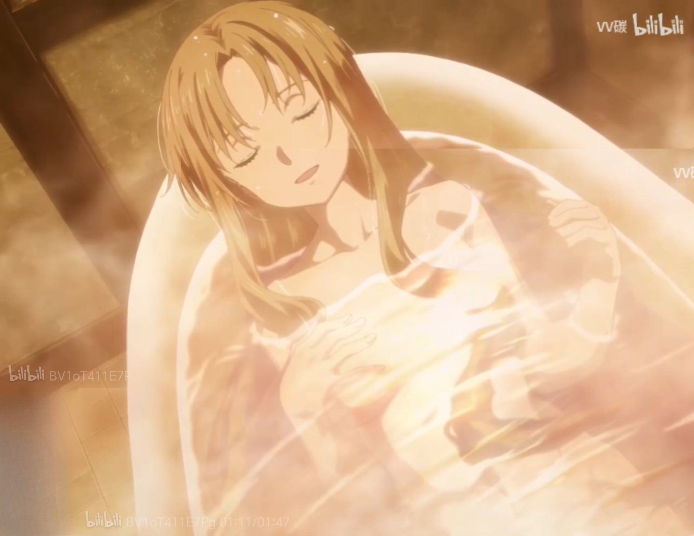

```bash
# 校验：应为 0.000%
python3 -c "import cv2;im=cv2.imread('anime/亚丝娜镜头1/translate_stitched_clean.png');print((im.max(axis=2)<8).mean()*100)"
```

### 遗留问题（未处理，属数据限制）

- **镜头2 的 bilibili 水印**（右上 logo、`BV1oT411E7eg 01:14/01:47`、`01:11/01:47`）。背景是有细节的暖光，涂抹痕迹会比水印更明显。
- **镜头1 接缝 1:1 放大仍有极淡重影线**——两帧重叠内容在接缝两侧有轻微错位（非曝光问题，MSE 曲线无最优位移，属原片视差/形变），整图观看不可见。
- 镜头1 左下红色模糊块、斜向蓝色光带是**原画面内容**，不是拼接缺陷。
