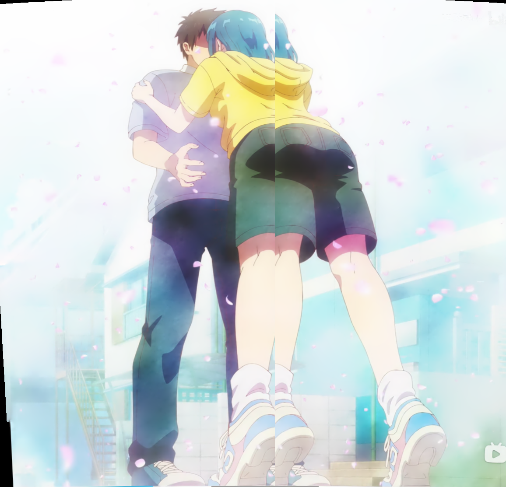
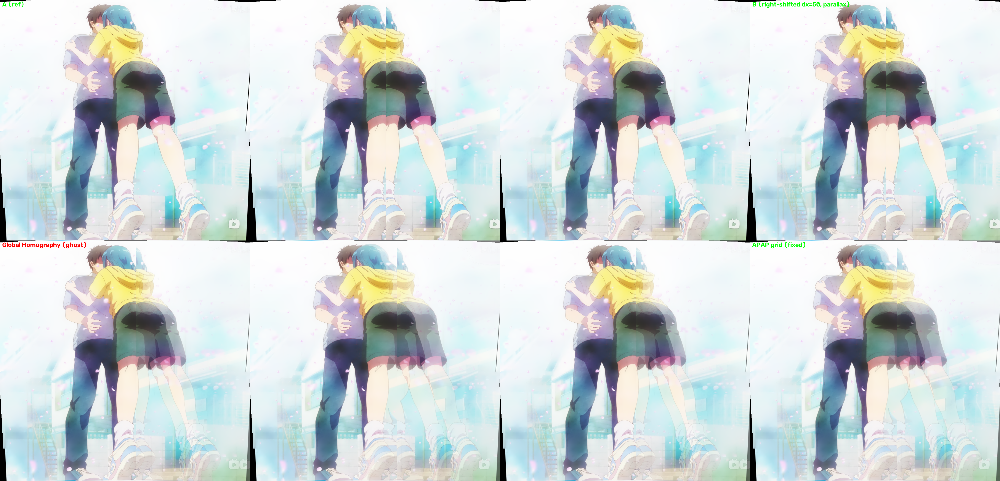

# APAP 局部网格对齐 vs 全局单应（视差 / 曲线场景对比）

## 目的
前面三张截图是**纯平移**，全局单应（Stitcher）就足够。但真实"曲线移动 / 非平面"场景会产生**视差**：前景物体相对背景有不同位移，此时**单个全局单应无法同时对齐前景和背景 → 重影**。本实验演示 APAP（As-Projective-As-Possible）如何用**网格局部单应**修正。

## 合成视差对
取拼接完成的图作底图，构造 A / B 两图：**B 的右半（前景/人物）相对 A 右移 50px**，模拟"前景相对背景的视差"。




## 对比结果
- **全局单应**：RANSAC 估计 `H_global ≈ 单位矩阵`（对齐了背景），但 B 右半 50px 视差 → **右半人物/背景双影、模糊**。
- **APAP**：把图分 **12×12 网格**，逐顶点用邻近匹配点估计局部单应，再做双线性形变 warp → **右半被局部修正，人物更锐利**。



## 机制
- **全局单应**：所有像素用同一个 H → 只能对齐一个平面，前景/背景只能二选一。
- **APAP**：每个网格顶点有自己的局部 H（基于邻近匹配点），像素用四角顶点位移做双线性插值 → 可**同时对齐背景与前景**。
- 进一步：**MeshFlow / CPW** 用运动网格处理相机轨迹连续变化，更适合视频/长序列；**深度方法**（Parallax-Tolerant Deep Stitching）端到端容忍视差。

## 代码
`apap.py`：`get_matches()`（SIFT+RANSAC）、`apap_warp()`（网格局部单应 + 双线性形变 + remap）、合成视差对、全局 vs APAP 对比输出。

运行：
```bash
cd /workspace
.venv/bin/python anime/apap.py
```

## 产物（`/workspace/anime/`）
- `synth_A.png` / `synth_B.png` — 合成视差对
- `baseline_global.png` — 全局单应拼接（重影）
- `apap_result.png` — APAP 网格对齐拼接
- `compare.png` — 并排对比

## 选型建议
| 场景 | 方法 |
|---|---|
| 纯平移 / 远平面 | 全局单应（OpenCV Stitcher，最快最稳） |
| 有视差 / 非平面 | APAP（局部单应）或 MeshFlow（运动网格） |
| 视差严重 / 大规模 | Parallax-Tolerant Deep Stitching 等深度方法 |
| 你的三张垂直截图（纯平移） | 全局单应即可，APAP 属"更普遍情况"的备用方案 |
