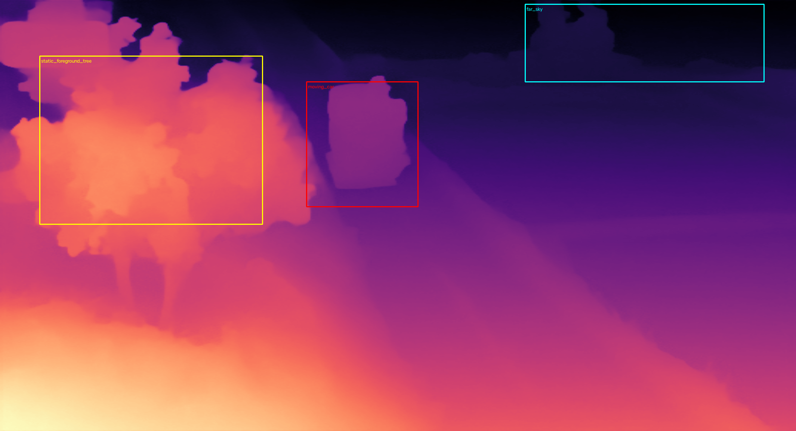

# 龙猫斜向 pan 镜头：方法层 XY 对照实验

素材 `龙猫/`（4 帧，裁黑边后 2130×1156，斜向上运镜，**画面内有运动的汽车**，另有屏幕固定位置的 bilibili 水印与左上角台标）。

**X 轴 = 位移估计 / 主体处理方法**（7 种），**Y 轴 = 融合策略**（5 种），共 35 组；所有方法共用同一套 Kruskal 最大生成树布局，只有估计器不同。

## 1. X 轴：位移估计结果（含 x / y 两个方向分量）

| 方法 | pos 跨度 x / y (px) | 相对 SIFT 最大偏差 (px) | 估计耗时 (ms) | 说明 |
|---|---|---|---|---|
| `sift` | 271.8 / 912.9 | 0.0 | 11954 | baseline |
| `orb` | 0.0 / 2.0 | 953.4 | 3135 | 收敛失败：位移≈0（诊断项） |
| `phase` | 271.2 / 913.5 | 0.9 | 538 |  |
| `ecc` | 0.2 / 0.2 | 952.5 | 8372 | 收敛失败：位移≈0（诊断项） |
| `ecc_init` | 271.4 / 912.3 | 0.6 | 6664 |  |
| `motionmask` | 272.4 / 913.2 | 0.7 | 5288 |  |
| `depth` | 273.5 / 912.1 | 1.8 | 6468 | 需模型 |

布局跨度约 **x 272px / y 913px**（斜向上 pan，y 分量是 x 的 3.4 倍）。`phase` 相对 SIFT 的最大偏差只有 0.88px，单对估计却快约 22 倍。

- **ORB**：6 个图片对里 5 个收敛到 `(0,0)` 假峰——动画平坦区 ORB 描述子重复，假峰内点率反而高于真实位移（加 CLAHE 也压不住），`bg_p60≈75` 即布局失效。
- **纯 ECC**：大位移超出收敛域，从单位阵起步掉进 `(0,0)` 局部极小；`ecc_init` 用相位相关的 `+d` 初始化后才收敛（合成位移测试确认 ECC warp 与特征点位移同号，从 0 或 `-d` 起步都会失败）。
- `bg_p60` / `ghost%` 明显崩坏的行，说明该估计器给出的布局不可用。

## 2. 全矩阵指标

`bg_p60` = MST 边重叠区逐像素差的 60 分位（越小越对齐）；`ghost%` = 差值 >30 的像素占比（错位/运动主体）；`row/col` = 整图最大亮度跳变；`OSD` = 融合图里检测到几次固定台标（越少越好）。

> `bg_p60` / `ghost%` 只取决于 X 轴的几何布局，所以同一行内恒定；**Y 轴的差异要看 `OSD` / `seam` / `row` / `col` 和融合耗时**。

| X | Y | 尺寸 | bg_p60 | ghost% | OSD | row | col | seam | 黑区% | 融合 ms |
|---|---|---|---|---|---|---|---|---|---|---|
| `sift` | `mean` | 2402x2069 | 5.67 | 6.17 | 4 | 29.34 | 23.50 | 35.46 | 6.657 | 225 |
| `sift` | `median` | 2402x2069 | 5.67 | 6.17 | 2 | 29.34 | 27.31 | 5.70 | 6.681 | 1301 |
| `sift` | `multiband` | 2402x2069 | 5.67 | 6.17 | 4 | 29.01 | 22.70 | 12.95 | 6.680 | 263 |
| `sift` | `feather` | 2402x2069 | 5.67 | 6.17 | 4 | 30.58 | 23.68 | 37.61 | 6.681 | 124 |
| `sift` | `seam` | 2402x2069 | 5.67 | 6.17 | 1 | 29.34 | 20.36 | 5.64 | 6.710 | 2937 |
| `orb` | `mean` | 2130x1158 | 75.33 | 82.67 | 1 | 24.37 | 2.51 | 5.31 | 0.001 | 90 |
| `orb` | `median` | 2130x1158 | 75.33 | 82.67 | 1 | 35.69 | 2.59 | 5.54 | 0.001 | 642 |
| `orb` | `multiband` | 2130x1158 | 75.33 | 82.67 | 1 | 28.36 | 2.35 | 5.01 | 0.000 | 128 |
| `orb` | `feather` | 2130x1158 | 75.33 | 82.67 | 1 | 24.36 | 2.51 | 5.30 | 0.001 | 94 |
| `orb` | `seam` | 2130x1158 | 75.33 | 82.67 | 1 | 38.23 | 3.23 | 6.20 | 0.176 | 248 |
| `phase` | `mean` | 2401x2070 | 5.67 | 6.21 | 4 | 31.52 | 21.00 | 38.78 | 6.645 | 199 |
| `phase` | `median` | 2401x2070 | 5.67 | 6.21 | 2 | 29.35 | 27.37 | 6.53 | 6.661 | 1288 |
| `phase` | `multiband` | 2401x2070 | 5.67 | 6.21 | 4 | 29.02 | 16.21 | 13.31 | 6.661 | 190 |
| `phase` | `feather` | 2401x2070 | 5.67 | 6.21 | 4 | 34.04 | 22.12 | 41.48 | 6.662 | 126 |
| `phase` | `seam` | 2402x2070 | 5.67 | 6.21 | 1 | 29.34 | 47.54 | 6.55 | 6.725 | 2364 |
| `ecc` | `mean` | 2131x1157 | 63.33 | 75.87 | 1 | 35.83 | 102.98 | 5.55 | 0.050 | 69 |
| `ecc` | `median` | 2130x1156 | 63.33 | 75.87 | 1 | 39.81 | 15.59 | 5.43 | 0.001 | 444 |
| `ecc` | `multiband` | 2130x1156 | 63.33 | 75.87 | 1 | 35.61 | 13.01 | 5.27 | 0.001 | 82 |
| `ecc` | `feather` | 2130x1156 | 63.33 | 75.87 | 1 | 36.19 | 15.53 | 5.55 | 0.002 | 54 |
| `ecc` | `seam` | 2131x1157 | 63.33 | 75.87 | 1 | 40.56 | 89.13 | 6.06 | 0.068 | 144 |
| `ecc_init` | `mean` | 2401x2068 | 5.67 | 6.20 | 4 | 29.35 | 24.73 | 35.46 | 6.643 | 142 |
| `ecc_init` | `median` | 2401x2068 | 5.67 | 6.20 | 2 | 29.35 | 27.33 | 6.64 | 6.654 | 930 |
| `ecc_init` | `multiband` | 2401x2068 | 5.67 | 6.20 | 4 | 29.02 | 22.62 | 13.39 | 6.654 | 138 |
| `ecc_init` | `feather` | 2401x2068 | 5.67 | 6.20 | 4 | 40.36 | 23.80 | 48.32 | 6.654 | 88 |
| `ecc_init` | `seam` | 2402x2069 | 5.67 | 6.20 | 1 | 30.16 | 34.31 | 3.46 | 6.715 | 2306 |
| `motionmask` | `mean` | 2402x2069 | 6.00 | 7.74 | 4 | 31.28 | 22.58 | 38.53 | 6.665 | 140 |
| `motionmask` | `median` | 2402x2069 | 6.00 | 7.74 | 2 | 29.34 | 23.26 | 6.16 | 6.680 | 953 |
| `motionmask` | `multiband` | 2402x2069 | 6.00 | 7.74 | 4 | 29.01 | 21.29 | 13.22 | 6.679 | 124 |
| `motionmask` | `feather` | 2402x2069 | 6.00 | 7.74 | 4 | 35.61 | 21.62 | 43.20 | 6.680 | 86 |
| `motionmask` | `seam` | 2403x2070 | 6.00 | 7.74 | 1 | 31.16 | 38.63 | 5.78 | 6.775 | 2421 |
| `depth` | `mean` | 2403x2068 | 5.67 | 6.24 | 4 | 29.33 | 21.93 | 28.30 | 6.683 | 137 |
| `depth` | `median` | 2403x2068 | 5.67 | 6.24 | 2 | 29.33 | 21.66 | 6.51 | 6.697 | 959 |
| `depth` | `multiband` | 2403x2068 | 5.67 | 6.24 | 4 | 29.00 | 21.26 | 12.71 | 6.697 | 136 |
| `depth` | `feather` | 2403x2068 | 5.67 | 6.24 | 4 | 29.33 | 21.66 | 36.37 | 6.697 | 88 |
| `depth` | `seam` | 2404x2069 | 5.67 | 6.24 | 1 | 31.55 | 33.24 | 3.05 | 6.798 | 3186 |

## 3. 运动主体 / 为什么深度估计不是解决办法

- 第 1 帧被判为「运动/非背景」的面积占比：**3.96%**；SIFT RANSAC 内点落在该区域的比例：**7.97%**。
- 运动 / 非背景区域只占有效画面约 **4.0%**，而纯平移 RANSAC 的强峰有 1000+ 内点，显然来自背景；落在大差异区的内点主要是固定 OSD 与曝光差异，不是车本体。**汽车被自动当外点剔除，拼接结果无重影**（`motion_analysis.png`：红色是车，绿点是内点）。
- `motionmask`（帧差剔主体）与 `depth`（按深度分位剔匹配点）相对 baseline 的最大布局偏差：`motionmask` 0.69px、`depth` 1.83px → **显式主体识别没有改变几何结论**。

### 3.1 深度给的是「远近」，不是「动静」

最容易被误解的一点：**静态前景树完全可能比运动的车更靠近镜头**，所以「深度估计 → 剔近景 → 忽略运动主体」这条链本身就不成立。`--depth-audit` 用同一份权重做了定量验证（`depth_audit.json` / `depth_audit.png`）：

| 区域 | 深度均值 | 匹配点 | 按 70 分位剔「近景」时被剔掉 |
|---|---|---|---|
| 静态前景树（不动） | 3.980 | 484 | 418 |
| 运动汽车（要忽略的） | 2.076 | 16 | 9 |
| 远景天空 | 0.463 | 83 | 0 |

**静态前景树 3.980 > 运动汽车 2.076**：树比车「近」近一倍。树上 484 个匹配点被剔掉 418 个（86%），车上 16 个点只剔掉 9 个，远景 0 个 → **深度掩膜实际在剔静止的树，几乎没碰运动主体**。

这也解释了 `depth` 方法的方向自适应为什么在 `keep_far` / `keep_near` 之间摇摆（6 个 pair 里 3:3）：深度排序与「是否在运动」无关，本来就不存在一个正确方向。识别运动主体要靠**跨帧一致性**（帧差 / 光流 / RANSAC 外点），而不是单帧几何。



- 融合阶段运动主体有三种命运：`mean` / `multiband` / `feather` 把 4 个位置的车平均成淡影，`median` 直接把车抹掉（背景最干净），`seam` 只保留**恰好一辆车**。见 `grid.png` 最后一列。
- 固定 OSD 同理（台标在每帧屏幕坐标不动，拼接后按各帧位置重复）：`mean` / `multiband` / `feather` 残留 4 份，`median` 2 份，`seam` 1 份。深度估计对此无效——OSD 没有深度。
- 所以「忽略主体」要分清三层：① **估计位移时**忽略（纯平移 RANSAC 已做到）；② **融合时**消除重复主体（`median` / `seam`）；③ 保留一个主体（只有 `seam`）。

## 4. 速度与浏览器部署

| 方法 | 单对估计 (ms) | 浏览器 JS | 备注 |
|---|---|---|---|
| `sift` | 1992 | OpenCV.js SIFT 可用，较慢 | baseline |
| `orb` | 523 | OpenCV.js / jsfeat 可直接实现 | 收敛失败：位移≈0（诊断项） |
| `phase` | 90 | OpenCV.js / jsfeat 可直接实现 | — |
| `ecc` | 1395 | OpenCV.js / jsfeat 可直接实现 | 收敛失败：位移≈0（诊断项） |
| `ecc_init` | 1111 | OpenCV.js / jsfeat 可直接实现 | — |
| `motionmask` | 881 | OpenCV.js / jsfeat 可直接实现 | — |
| `depth` | 1078 | 需要 ONNX Runtime Web（WebGPU/WASM） | 需模型 |
| `depth(infer)` | 722 | int8 ONNX，CPU 0.72s/帧 | 4 帧缓存 |

**结论（面向浏览器 JS）**：`phase` 单对约 90ms，比 SIFT 快约 22 倍、位移偏差 <1px，OpenCV.js 原生就有 `phaseCorrelate`。配合 `seam`（保留一辆车、台标 1 份）或 `median`（更快、背景最干净）即可，**不必跑深度模型**；SIFT / ORB / ECC 都不是必需的。

若确实要做主体级 3D / 景深效果，再上下面的 int8 ONNX；但注意在本实验里它只用于「按深度分位剔匹配点」，而这件事 RANSAC 免费做完了、且深度掩膜剔错了对象（见 3.1）。

> 本实验只到「融合」为止，故 `黑区%` 仍是原始画布的未覆盖区域；真实出图再走 `collage.py` 的 LaMa 清理阶段（实测可清到 0.000%）。

### 4.1 深度模型：完整规格与一键复现

| 项 | 值 |
|---|---|
| HuggingFace 仓库 | `onnx-community/depth-anything-v2-small` |
| 权重文件 | `onnx/model_int8.onnx` |
| 原模型 | `depth-anything/Depth-Anything-V2-Small`（ViT-S 编码器 + DPT 头），Apache-2.0 |
| 大小 / sha256 | 27,258,801 B（26 MB） / `01aa7a23de3f4a0ee1a2bb9997e6918104c85a9f95dea46d27b9b3fb0c6b9001` |
| 输入 | `pixel_values` float32 `[1,3,518,518]`，RGB，减 ImageNet mean / 除 std，bicubic resize 到 518×518 |
| 输出 | `predicted_depth` `[1,518,518]` 相对深度；实测值越大越近（树 3.98 > 车 2.08 > 天空 0.46） |
| 推理 | ONNX Runtime 1.31.1 CPUExecutionProvider，约 0.5–0.7s/帧（2130×1156 输入缩到 518×518） |
| 浏览器 | 同一份权重交给 transformers.js 的 `depth-estimation` pipeline 或 ONNX Runtime Web（WebGPU fp16 / WASM 回退） |
| 下载 URL | `https://huggingface.co/onnx-community/depth-anything-v2-small/resolve/main/onnx/model_int8.onnx` |

**从零到跑通**（项目根目录，完整命令，不简写）：

```bash
uv venv /tmp/anime-venv
uv pip install --python /tmp/anime-venv/bin/python opencv-python-headless numpy onnxruntime
bash setup_depth.sh --check
/tmp/anime-venv/bin/python method_lab.py 龙猫
/tmp/anime-venv/bin/python method_lab.py 龙猫 --depth-audit
```

只下模型（等价于 `setup_depth.sh` 的下载部分）：

```bash
curl -L --fail -o models/depth_anything_v2_small_int8.onnx \
  https://huggingface.co/onnx-community/depth-anything-v2-small/resolve/main/onnx/model_int8.onnx
```

不下模型也能跑 6 种方法的矩阵：

```bash
/tmp/anime-venv/bin/python method_lab.py 龙猫 --no-depth
/tmp/anime-venv/bin/python method_lab.py 龙猫 --quick          # 只跑 3 种融合
```

`setup_depth.sh` 会校验字节数与 sha256；`--check` 额外用 ONNX Runtime 跑一次 518×518 随机输入，打印输入输出规格。`--model PATH` 可换其它 ONNX 权重。

## 5. 相关论文 / 项目索引

| 工作 | 会议 / 年份 | 代码 / 链接 | 与本任务的关系 |
|---|---|---|---|
| FE2E: From Editor to Dense Geometry Estimator | CVPR 2026 | [代码/主页](https://github.com/AMAP-ML/FE2E) | DiT 编辑模型先验做 depth+normal；依赖 step1x-edit / VAE / LoRA，GPU 级，不适合浏览器 |
| Jasmine: Harnessing Diffusion Prior for Self-Supervised Depth Estimation | NeurIPS 2025 | [代码/主页](https://github.com/wangjiyuan9/Jasmine) | Stable Diffusion 自监督深度，MIR + Scale-Shift GRU；arXiv 2503.15905 |
| D4RD: Digging into Contrastive Learning for Robust Depth Estimation with Diffusion Models | ACM MM 2024 | [代码/主页](https://github.com/wangjiyuan9/D4RD) | 扩散深度在雨/雪等恶劣条件的鲁棒性；arXiv 2404.09831 |
| Marigold / Marigold V2 | CVPR 2024 / SIGGRAPH Asia 2026 | [代码/主页](https://huggingface.co/spaces/prs-eth/marigold) | 扩散先验零样本深度；V2 见 https://github.com/huawei-bayerlab/marigold-v2 |
| Metric3D v2 | TPAMI 2024 | [代码/主页](https://github.com/YvanYin/Metric3D) | 有尺度（米）深度 + 法线，精度高、适合 3D 重建；ViT-giant 很重 |
| BetterDepth | （用户提到） | — | 针对深度平滑 / 主体内部深度丢失（狮子例子）；检索时未见独立官方开源仓库，同期 Marigold V2 在细粒度细节上有类似目标 |
| Depth Anything V2 Small | 2024 · Apache-2.0 | [代码/主页](https://github.com/DepthAnything/Depth-Anything-V2) | **本实验采用**：onnx-community/depth-anything-v2-small 的 int8 ONNX（26 MB） |
| MiDaS | 2021 | [代码/主页](https://github.com/isl-org/MiDaS) | 更老的轻量 small 模型，ONNX / TF.js 生态成熟 |
| Transformers.js / ONNX Runtime Web | — | [代码/主页](https://huggingface.co/docs/transformers.js) | 浏览器端 depth-estimation pipeline，WebGPU fp16 / WASM 回退 |
| Depth Anything on Browser | — | [代码/主页](https://github.com/akbartus/DepthAnything-on-Browser) | 纯前端深度估计 demo |
| PlaneToPBR | — | [代码/主页](https://github.com/ScarlettVFX/PlaneToPBR) | 平面照片 → PBR 材质（3D 场景工具链） |

3D / MC 场景生成工具链：[Krea](https://www.krea.ai/home)、[Tripo3D](https://www.tripo3d.ai/)、[Hyper3D Rodin](https://hyper3d.ai/rodin)、[TRELLIS](https://huggingface.co/spaces/JeffreyXiang/TRELLIS)、[objtoschematic](https://objtoschematic.com/)、[Blender](https://www.blender.org/)、[depth-map-batch](https://blendermarket.com/products/depth-map-batch-for-images)、[zform](https://blendermarket.com/products/zform)、[BlockBlender](https://blendermarket.com/products/blockblender)、[BlockBlenderToSchem](https://bryanvalc.gumroad.com/l/BlockBlenderToSchem)、[B站 MC 建筑教程](https://b23.tv/nTopUmD)（上集 BV1ifqBYqEzk）、[知乎推文](https://zhuanlan.zhihu.com/p/1894794247015757493)。

本地克隆的参考仓库放在 `anime/methods/`（第三方代码快照，由 `.gitignore` 排除，不随项目提交）：`FE2E/`、`Jasmine/`、`D4RD/`、`MiDaS/`、`PlaneToPBR/`、`DepthAnything-on-Browser/`、`Depth-Anything-V2/`。
